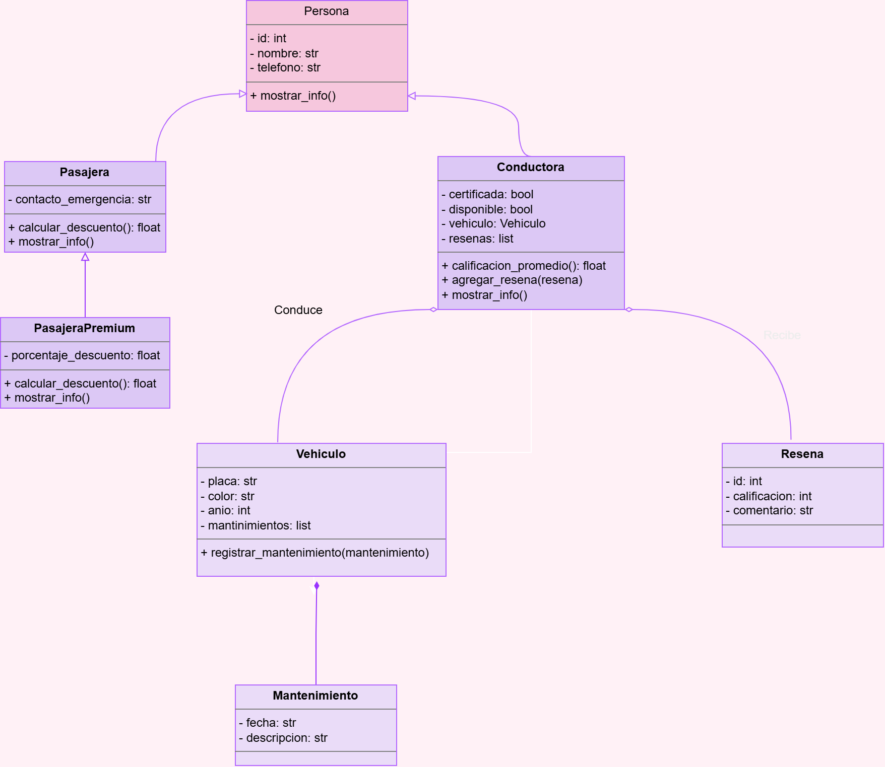
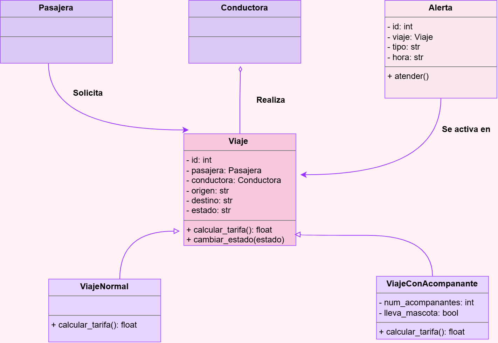
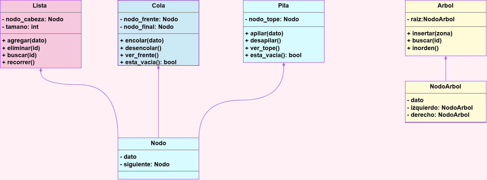
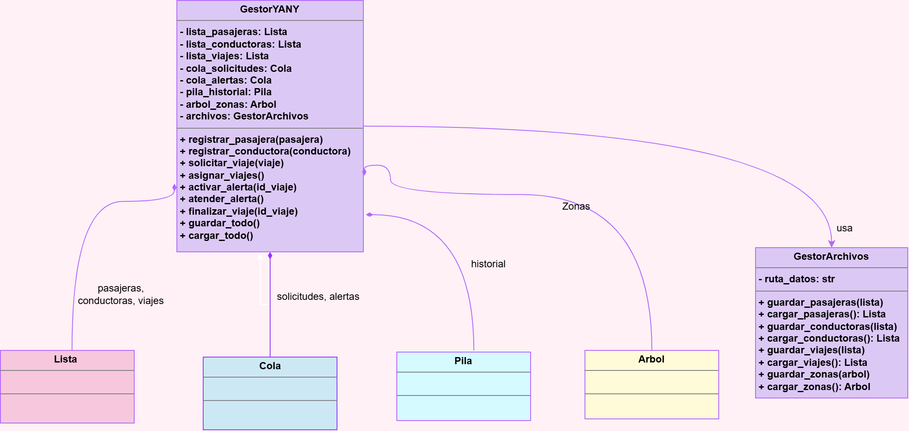
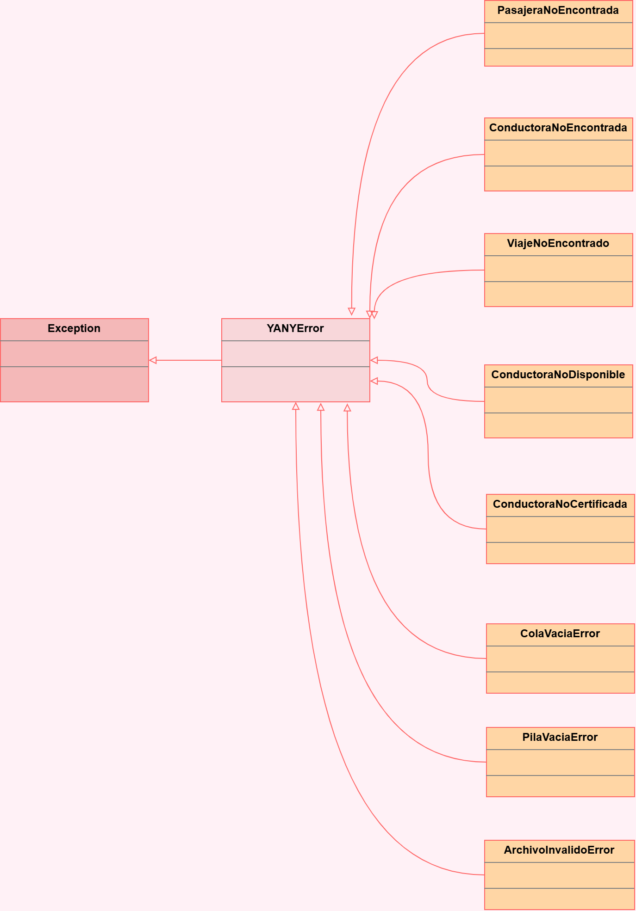

# YANY 🚗💜
**Una plataforma de movilidad de mujeres y para mujeres.**

Proyecto final de *Estructura de Datos* – Ingeniería en Ciencia de Datos, Instituto Tecnológico Metropolitano (ITM).

---

## 1. ¿Qué es YANY?

YANY es una aplicación de transporte privado en la que **tanto las conductoras como las pasajeras son únicamente mujeres**. Nació como proyecto de media técnica y en este repositorio se implementa su núcleo en Python, aplicando estructuras de datos y programación orientada a objetos.

## 2. Problema

Las mujeres enfrentan situaciones de acoso y de inseguridad al movilizarse en transporte público y privado. Las conductas más comunes incluyen tocamientos, comentarios obscenos y retención en el vehículo, y muchas veces la ayuda llega tarde.

**Pregunta problematizadora:** ¿Puede la creación de una app de transporte privado para mujeres y conducida por mujeres garantizar la seguridad a la hora de movilizarse?

## 3. Objetivos

**General:** crear una app de transporte privado para mujeres conducida por mujeres.

**Específicos (de esta versión en Python):**
- Modelar usuarias, vehículos, viajes, reseñas y alertas con clases y herencia.
- Gestionar solicitudes, alertas, historial y zonas con estructuras de datos propias.
- Persistir la información en archivos JSON.
- Validar los datos y manejar errores con excepciones propias.
- Probar el código con pruebas automáticas (pytest).

## 4. Funcionalidades

- **Conductoras certificadas**, con vehículo y mantenimiento registrados.
- **Pasajeras** con contacto de emergencia y **pasajeras Premium** (descuento en el viaje).
- **Botón de emergencia / alertas**: se atienden primero que cualquier solicitud normal.
- **Viajes con acompañante o mascota**: la pasajera debe informarlo para que la conductora esté enterada y quede registro.
- **Reseñas y calificaciones** de las conductoras.
- **Historial de viajes** y organización por **zonas**.
- **Página web** (`index.html`) para registrarse como pasajera o conductora, iniciar y cerrar sesión, solicitar viajes con ruta en Google Maps, ver la tarifa estimada y consultar el historial.
- **Gestión de perfiles** de pasajeras y conductoras.

## 5. Tecnologías utilizadas

- **Python:** lenguaje principal del proyecto.
- **Flask:** servidor y rutas web.
- **HTML, CSS y JavaScript:** interfaz de usuario.
- **Google Maps:** visualización de mapas y rutas.
- **JSON:** almacenamiento de la información.
- **pytest:** pruebas automáticas.

## 6. Estructuras de datos y dónde se usan

| Estructura | Uso en YANY |
|---|---|
| Lista enlazada (`Nodo`, `Lista`) | Registro de pasajeras, conductoras y reseñas |
| Cola | Solicitudes de viaje y alertas (las alertas se atienden primero) |
| Pila | Historial de viajes (el más reciente primero) |
| Árbol binario de búsqueda (`NodoArbol`, `Arbol`) | Zonas ordenadas por `id`: `insertar`, `buscar` e `inorden` |
| Archivos JSON | Persistencia de pasajeras, conductoras y viajes en la carpeta `datos/` |

## 7. Diseño

Los diagramas de clases están en la carpeta [`docs/`](docs/):







**Herencia y polimorfismo:**
- `Persona → Pasajera → PasajeraPremium` y `Persona → Conductora`.
- `Viaje → ViajeNormal` y `Viaje → ViajeConAcompanante`.
- Los métodos `mostrar_info()`, `calcular_descuento()` y `calcular_tarifa()` se sobrescriben en las clases hijas.

**Otras clases del dominio:** `Vehiculo`, `Mantenimiento`, `Resena`, `Alerta` y `Zona`.

**Encapsulamiento:** los atributos son privados (`__atributo`), se leen con `@property` y los setters validan los datos y lanzan `ValueError`. El `id` solo tiene getter.

## 8. Estructura del proyecto

```
Yany/
├── yany/          # Clases del dominio (persona, pasajera, conductora, viaje, alerta, zona, ...)
├── estructuras/   # Lista, Cola, Pila, Árbol, Nodo
├── gestores/      # GestorYANY y GestorArchivos
├── datos/         # Archivos JSON (conductoras, pasajeras, viajes)
├── pruebas/       # Pruebas con pytest
├── docs/          # Diagramas de clases
├── web/           # Rutas y plantillas de la página web
├── img/           # Imágenes y logo
├── index.html     # Página principal
├── main.py        # Programa principal (consola)
├── app.py         # Servidor web (Flask)
└── requirements.txt
```

## 9. Instalación y ejecución

1. Clonar el repositorio y abrir una terminal en la carpeta principal:

```bash
git clone https://github.com/DanielaZapata/Yany.git
cd Yany
```

2. Instalar las dependencias:

```bash
pip install flask pytest
```

3. Ejecutar la aplicación web:

```bash
python app.py
```

4. Abrir en el navegador `http://127.0.0.1:5000`.

En Windows, si `python` o `pip` no se reconocen, usa `py` y `py -m pip`.

## 10. Pruebas

Desde la raíz del proyecto:

```bash
python -m pytest pruebas
```

Cada clase tiene su archivo `test_<clase>.py` en `pruebas/`. Se prueban los casos normales, los errores de validación (`pytest.raises`) y el polimorfismo.

## 11. Convenciones del equipo

- El descuento de las pasajeras Premium se guarda como **fracción** (`0.05` = 5 %).
- La calificación promedio de una conductora sin reseñas es `0.0`.
- Las calificaciones de las reseñas van de 1 a 5.
- El estado de un viaje es `Solicitado`, `En_curso`, `Finalizado` o `Cancelado`; un viaje finalizado o cancelado no puede cambiar de estado.
- Los viajes con acompañante suman un recargo por cada acompañante y otro si lleva mascota, sobre la tarifa del viaje normal.
- Las alertas son de tipo `Emergencia`, `Acoso`, `Accidente` o `Ruta desviada`, y una alerta solo se puede atender una vez.
- Los `id` de las zonas no se pueden repetir.
- Un trabajo por rama (`nombre`), integración a `main` mediante Pull Request.

## 12. Equipo

- Jimena Hurtado Reyes
- María Camila Hurtado Reyes
- Laura Sofía Diaz Henao
- Daniela Zapata Gutierrez

## 13. Origen del proyecto

La idea original (problema, encuesta de validación, visión de producto y modelo entidad-relación) fue creada por Jimena Hurtado y Camila Hurtado y Sofia Quejada en su proyecto de media técnica, y se retoma aquí como proyecto de Estructura de Datos.

## 14. Fuentes

Las cifras y el contexto del problema se apoyan en estas fuentes:

**1. Casos de acoso en el transporte**
- [El Tiempo – Medellín: alerta por casos de acoso sexual en sistemas de transporte](https://www.eltiempo.com/colombia/medellin/medellin-alerta-por-casos-de-acoso-sexual-en-sistemas-de-transporte-754727)
- [Semana – Joven denuncia que fue víctima de acoso sexual mientras se dirigía a su casa en un taxi en Medellín](https://www.semana.com/nacion/medellin/articulo/joven-denuncia-que-fue-victima-de-acoso-sexual-mientras-se-dirigia-a-su-casa-en-un-taxi-en-la-ciudad-de-medellin-senti-mucho-miedo/202332/)

**2. Participación de las mujeres en el sector automotor**
- [Allianz Colombia – Mujeres al volante](https://www.allianz.co/sala-de-prensa/comunicados/mujeres-al-volante.html)

**3. Datos de movilidad de las mujeres**
- Área Metropolitana del Valle de Aburrá – *Encuestas Origen-Destino 2025: Informe de Indicadores de Movilidad*, con la variable género ([PDF](docs/Informe_Movilidad_AMVA_2026-11-15.pdf)).

